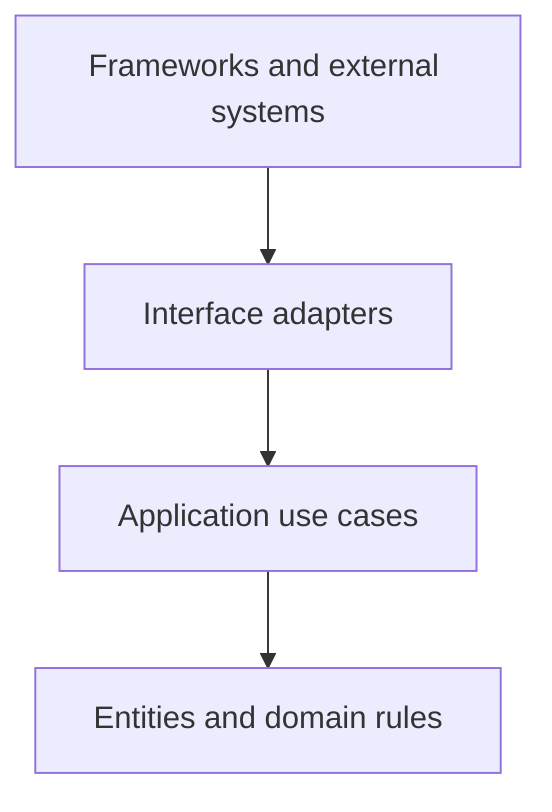

# Clean Architecture

## At a Glance

Clean Architecture is a family of design approaches that keep business policy independent from external details such as databases, web frameworks, message brokers and user interfaces.

Its central idea is dependency direction: source-code dependencies should point toward the business rules that are less likely to change for technical reasons.

## The Engineering Challenge

When business rules depend directly on frameworks or databases, changes to those tools can spread through the application. Clear boundaries help keep business logic testable and less dependent on infrastructure.

## Architecture Blueprint

The arrows show a simplified source-dependency direction, not necessarily runtime call flow. An inner use case may call an interface implemented by an outer infrastructure component.

## Where It Fits

Consider this approach when business rules are substantial, long-lived or important to test independently of infrastructure. It can also help when several delivery mechanisms or external systems use the same application policy.

For a small application with little domain behavior, a lighter structure may be easier to maintain.

## Trade-offs & Pitfalls

- Interfaces and mapping code can add ceremony.
- Excessive abstraction can make simple flows harder to follow.
- Persistence or transport models can leak into inner layers.
- A folder structure named after Clean Architecture does not prove that dependencies point inward.

The dependency rule matters more than a prescribed folder structure.

## Building It in Practice

A common arrangement separates:

- **Domain rules:** core business concepts and invariants.
- **Use cases:** application-specific workflows.
- **Adapters:** translation between external formats and application models.
- **Infrastructure:** databases, frameworks, messaging and other external mechanisms.

Define interfaces at the boundary where they protect meaningful policy. Avoid adding abstractions that only create indirection.

## How It Connects

Clean Architecture can be used inside a layered application, a modular monolith or an individual microservice. It is not a deployment topology and does not require microservices.

## Further Reading & References

### Engineering Publications & Essays

- [The Clean Architecture - Robert C. Martin](https://blog.cleancoder.com/uncle-bob/2012/08/13/the-clean-architecture.html) - Published: 2012-08-13
- [Inversion of Control Containers and the Dependency Injection pattern - Martin Fowler](https://martinfowler.com/articles/injection.html) - Published: 2004-01-23
