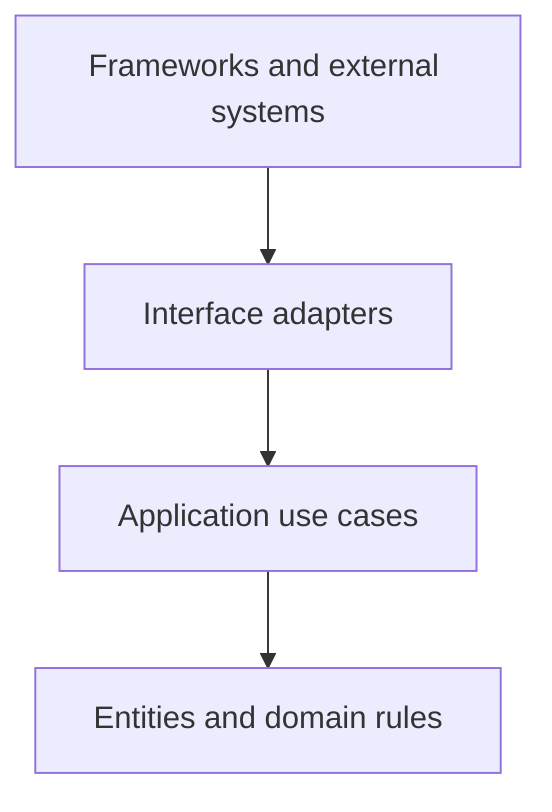

# Clean Architecture

Clean Architecture is a family of design approaches that place business policy toward the center of the system and keep it independent from external mechanisms such as databases, web frameworks, message brokers, and user interfaces.

Its defining concern is dependency direction: source-code dependencies should point inward toward policy that is less likely to change for technical reasons.

## Conceptual structure

The arrows represent a simplified dependency direction, not necessarily runtime call flow. At runtime, an inner use case may invoke an interface implemented by an outer infrastructure component. Dependency inversion allows the source dependency to remain inward-facing.

## Common elements

| Element | Responsibility |
|---|---|
| Entities or domain model | Core business rules and invariants |
| Use cases or application services | Application-specific workflows |
| Interface adapters | Translate between external formats and application models |
| Frameworks and infrastructure | Database, web, messaging, UI, and other external mechanisms |

Names and layer counts vary between implementations. The dependency rule matters more than a prescribed folder structure.

## Dependency rule

An inner policy layer should not import concrete details from an outer framework or database layer. Instead, define an interface or port at the inner boundary and implement it in an outer adapter.

This can make business logic easier to test without starting the real database, web server, or message broker. It also creates explicit seams for replacing infrastructure.

## Benefits

- Business rules can remain independent of delivery and persistence technology.
- Use cases can be tested with controlled dependencies.
- External integrations have explicit boundaries.
- Framework and database changes may be localized when abstractions are stable.

## Costs and failure modes

- Interfaces and mapping code can add ceremony.
- Excessive abstraction can make simple flows harder to follow.
- Poorly designed boundaries can leak persistence or transport models inward.
- A folder structure named after Clean Architecture does not prove that dependencies point inward.
- The approach does not automatically produce a good domain model.

## When it fits

Consider the approach when business rules are substantial, long-lived, or important to test independently of infrastructure. It can be especially useful when multiple delivery mechanisms or external systems interact with the same application policy.

For a small CRUD application with little domain behavior, a lighter structure may be more economical.

## How to assess an implementation

- Can domain and use-case code compile without importing web or database frameworks?
- Are external systems accessed through explicit interfaces?
- Do adapters translate external models at the boundary?
- Are use cases testable without infrastructure?
- Are abstractions protecting meaningful policy, or merely adding indirection?

## Relationship to other styles

Clean Architecture is compatible with layered architecture and modular monoliths. It is not itself a deployment topology and does not require microservices.

## Evidence status

This page describes dependency and maintainability principles. It does not claim a measured performance advantage.

## References

- [Robert C. Martin: The Clean Architecture](https://blog.cleancoder.com/uncle-bob/2012/08/13/the-clean-architecture.html)
- [Martin Fowler: Inversion of Control](https://martinfowler.com/articles/injection.html)
