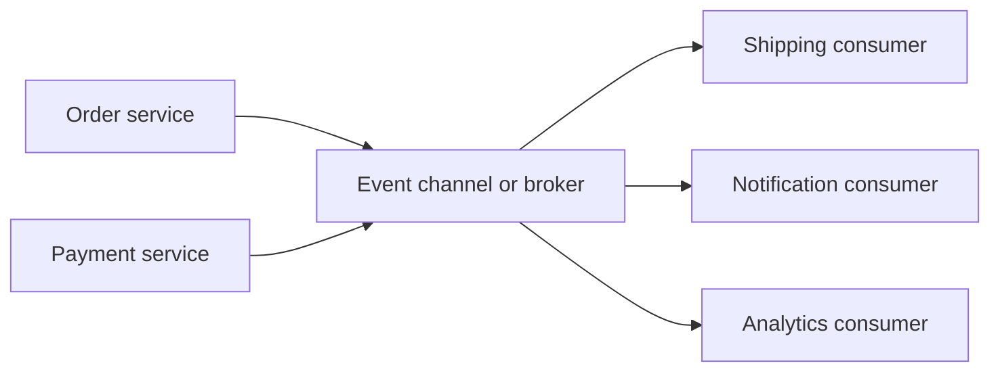

# Event-driven architecture

Event-driven architecture (EDA) structures communication around events: records that something meaningful has happened. Producers publish events; interested consumers receive and react to them, often asynchronously.

An event describes a fact that has occurred, such as `OrderPlaced`. It is different from a command, which asks a recipient to perform an action.

## Conceptual structure

The channel may be a broker, event stream, queue, or another transport. Not every event-driven design requires a centralized broker.

## Common components

- **Producers:** components that publish events.
- **Events:** immutable facts with defined meaning and schema.
- **Channels:** mechanisms that route or retain events.
- **Consumers:** components that react to events.
- **Schema and contract management:** rules for compatibility and evolution.
- **Operational controls:** retries, dead-letter handling, monitoring, replay, and access control where required.

## Common interaction topologies

### Broker topology

Producers publish events to a channel and consumers subscribe independently. The producer does not need to know which consumers exist. This can support fan-out and loose coupling.

### Mediator or orchestration topology

A coordinator controls a multi-step workflow and directs messages to participants. This can make process state and recovery more explicit, but it introduces a central coordination responsibility.

These topologies solve different problems; neither is universally superior.

## Benefits

- Producers and consumers can evolve with less direct knowledge of one another.
- Multiple consumers can react to the same business event.
- Asynchronous processing can keep long-running work out of a synchronous request path.
- Consumers may scale independently when the transport and workload support it.
- New consumers can sometimes be added without changing the producer.

## Costs and failure modes

- Eventual consistency means consumers may temporarily hold different views of state.
- Delivery can be duplicated; consumers should be idempotent where duplicate processing is possible.
- Ordering guarantees are usually scoped and transport-specific.
- Failed messages need retry, quarantine, and recovery policies.
- Event schemas evolve and can break consumers if compatibility is not managed.
- Tracing a workflow across asynchronous boundaries requires correlation and observability.
- Replay can repeat side effects unless consumers and external operations are designed for it.

## Delivery semantics

Do not assume exactly-once business effects merely because a broker advertises a delivery guarantee. End-to-end outcomes depend on producer persistence, transport behavior, consumer processing, acknowledgement, and side effects.

Common practical designs use at-least-once delivery with idempotent consumers. The transactional outbox pattern can help coordinate a database update with event publication; inbox or deduplication records can help consumers handle repeated delivery.

## When it fits

EDA is useful when multiple subsystems need to react to the same facts, workflows are naturally asynchronous, producers and consumers need temporal decoupling, or event streams are a core part of the domain.

## When it may not fit

For a simple request-response workflow with strict immediate consistency, an event broker may add unnecessary operational and reasoning overhead. If the team cannot monitor, retry, inspect, and recover asynchronous workflows, start with a simpler interaction model.

## Relationship to other styles

Event-driven communication can be used inside a modular monolith, between microservices, or in a layered application. It is a communication and coordination approach, not necessarily a deployment topology.

## Evidence status

This page explains architectural properties and trade-offs. It does not claim that EDA universally improves latency, throughput, or availability.

## References

- [Microsoft: Event-driven architecture style](https://learn.microsoft.com/en-us/azure/architecture/guide/architecture-styles/event-driven)
- [Martin Fowler: What do you mean by “Event-Driven”?](https://martinfowler.com/articles/201701-event-driven.html)
