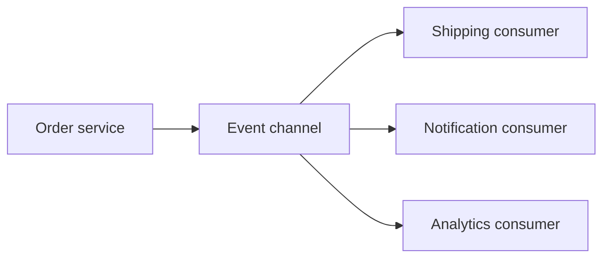

# Event-Driven Architecture

## At a Glance

Event-driven architecture (EDA) organizes communication around events: records that something meaningful has happened. Producers publish events, and interested consumers receive and react to them, often asynchronously.

An event such as `OrderPlaced` describes a fact. A command asks a recipient to perform an action.

## The Engineering Challenge

Direct calls can tightly connect a producer to the components that need to react to its work. Events allow producers and consumers to interact through a shared contract, which can reduce direct dependencies and support asynchronous workflows.

## Architecture Blueprint

For example, after an order is placed, separate consumers may arrange shipping, send a notification and update analytics. The producer does not need to coordinate each consumer directly.

The channel may be a broker, queue or event stream. Not every event-driven design needs a centralized broker.

## Where It Fits

EDA can help when multiple components need to react to the same business event, workflows are naturally asynchronous, or producers and consumers need to evolve with less direct coordination.

## Trade-offs & Pitfalls

- Consumers may process events later, so their views of data can temporarily differ.
- Messages may be delivered more than once; consumers should handle duplicates safely.
- Ordering guarantees depend on the transport and are often limited in scope.
- Failed messages need clear retry and recovery policies.
- Event schemas need compatibility rules as systems evolve.
- Tracing work across asynchronous components requires observability.

Do not assume a broker's delivery guarantee means exactly-once business effects. End-to-end behavior depends on the producer, transport, consumer and any external side effects.

## Building It in Practice

Define event meaning and schemas carefully. Use idempotent consumers where duplicate delivery is possible, and plan how to inspect, retry and recover failed messages. Patterns such as transactional outbox can help coordinate database updates with event publication when that consistency problem exists.

## When to Reconsider

For a simple request-response flow that needs immediate consistency, event infrastructure may add more operational and reasoning overhead than value. Start with a simpler interaction model if the team cannot monitor and recover asynchronous workflows.

## How It Connects

Event-driven communication can be used inside a modular monolith, between microservices or alongside a layered application. It is a communication approach, not necessarily a deployment style.

## Scope Note

EDA does not universally improve latency, throughput or availability. Outcomes depend on the workload, transport, implementation and operating environment.

## Further Reading & References

### Official Documentation & Architecture Guides

- [Event-driven architecture style - Microsoft](https://learn.microsoft.com/en-us/azure/architecture/guide/architecture-styles/event-driven) - Updated: 2026-03-07

### Engineering Publications & Essays

- [What do you mean by Event-Driven? - Martin Fowler](https://martinfowler.com/articles/201701-event-driven.html) - Published: 2017-02-07
