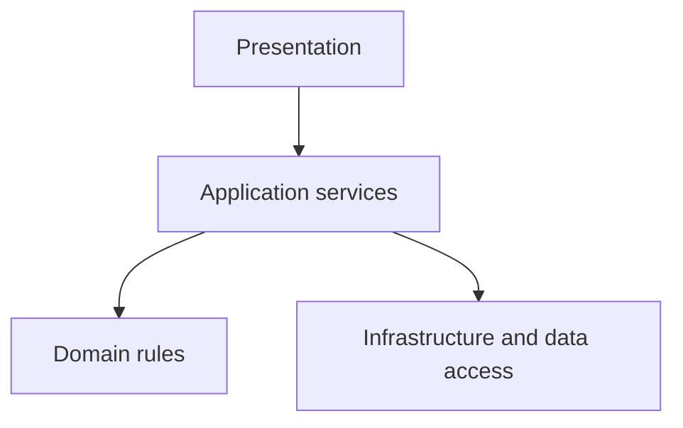

# Layered Architecture

## At a Glance

Layered architecture separates an application into groups of related responsibilities. A common design has presentation, application, domain and infrastructure layers.

It describes how code is organized; it does not prescribe a fixed number of folders, classes or technologies.

## The Engineering Challenge

As an application grows, user-interface code, business rules and data access can become tangled. Layers give each responsibility a clearer place and make dependencies easier to reason about.

## Architecture Blueprint

This is one common arrangement, not a universal dependency rule. Some designs use dependency inversion so infrastructure implements interfaces owned by inner layers. Document the actual dependency rules rather than inferring them from layer names.

| Layer | Typical responsibility |
|---|---|
| Presentation | HTTP endpoints, user interaction and request/response mapping |
| Application | Use-case coordination and workflow orchestration |
| Domain | Business rules and invariants |
| Infrastructure | Databases, messaging and external integrations |

## Where It Fits

Layering is a reasonable starting point when an application has familiar business workflows, a single deployment is appropriate, and the team needs clear separation between UI, business logic and data access.

## Trade-offs & Pitfalls

- **Pass-through layers:** code forwards calls without adding responsibility.
- **Change amplification:** a small feature requires edits across many layers.
- **Dependency leakage:** database or presentation types spread into business logic.
- **Scattered business rules:** important behavior ends up in controllers or service classes instead of a coherent domain model.

More layers do not automatically mean better separation. Keep boundaries that protect meaningful responsibilities.

## Building It in Practice

The same responsibility boundaries can be represented with Java packages, Python packages, Node.js modules or PHP namespaces. Frameworks can help organize code, but the team must still define and enforce the dependency rules.

## How It Connects

Layered architecture can be combined with a modular monolith. Clean Architecture adds a stronger focus on keeping source dependencies pointed toward business policy.

## Scope Note

This is design guidance, not evidence that layered applications are inherently faster or slower than other styles.

## Further Reading & References

### Official Documentation & Architecture Guides

- [Architecture styles - Microsoft](https://learn.microsoft.com/en-us/azure/architecture/guide/architecture-styles/) - Updated: 2025-10-14

### Engineering Publications & Essays

- [Presentation Domain Data Layering - Martin Fowler](https://martinfowler.com/bliki/PresentationDomainDataLayering.html) - Published: 2015-08-26
