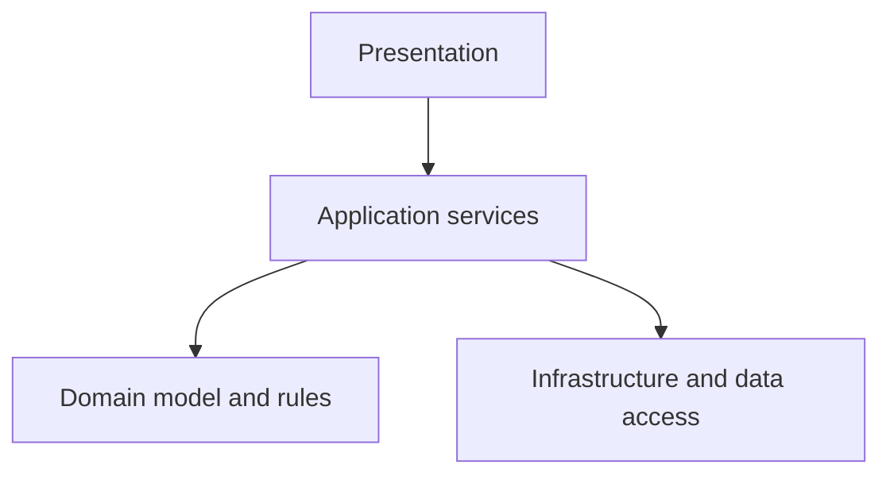

# Layered architecture

Layered architecture organizes software into horizontal groups of responsibilities. A common arrangement separates presentation, application services, domain or business logic, and infrastructure or data access.

It is a structural organization technique—not a requirement to create a particular number of folders or classes.

## Conceptual structure

This is one common arrangement, not a universal dependency rule. Some systems use ports and adapters so that infrastructure implements interfaces owned by inner layers. Others use a simpler call-down structure. Document the actual rules rather than inferring them from layer names.

## Responsibilities

| Layer | Typical responsibility |
|---|---|
| Presentation | HTTP endpoints, user interaction, request/response mapping |
| Application | Use-case coordination, transaction boundaries, workflow orchestration |
| Domain | Business rules, domain state, invariants |
| Infrastructure | Database access, messaging, external APIs, filesystem and framework integration |

A small application may combine some responsibilities. The important goal is coherent ownership and explicit dependencies, not maximizing the number of layers.

## Benefits

- Familiar mental model for many business applications.
- Responsibilities can be located and discussed consistently.
- Supports separation of business rules from delivery and persistence concerns when dependencies are controlled.
- Can make testing and onboarding straightforward.

## Costs and failure modes

- **Pass-through layers:** methods forward calls without adding meaningful responsibility.
- **Change amplification:** one small feature requires edits across many layers.
- **Anemic domain model:** business rules accumulate in application services while domain objects hold little behavior.
- **Dependency leakage:** presentation or persistence types spread into business logic.
- **Big ball of mud:** layer names exist, but modules remain tightly coupled.

## Dependency discipline

Define which layer may depend on which other layer. Enforce the policy with package boundaries, module rules, static analysis, or tests where practical. Avoid allowing every layer to access every other layer simply because it is convenient.

## When it fits

Layered organization is often a reasonable starting point when:

- The domain and workflows are relatively straightforward.
- The team benefits from conventional separation of UI, application, business, and data concerns.
- Most changes fit within a stable set of responsibilities.
- A single deployable application is appropriate.

It is not automatically unsuitable for complex domains. More deliberate domain and module boundaries may be needed as complexity grows.

## When to reconsider

Revisit the design when layers become pass-through abstractions, business rules are scattered, or changes routinely cross unrelated parts of the system. A modular monolith can add stronger business boundaries without requiring microservices.

## Relationship to other styles

- Layered architecture describes horizontal responsibility separation.
- Clean Architecture focuses more specifically on dependency direction toward inner policy.
- A modular monolith describes the deployment unit and internal module boundaries.

These approaches can be combined.

## Implementation notes

The style is language-agnostic. Java packages, Python packages, Node.js modules, and PHP namespaces can all represent layers. The language or framework does not enforce the boundaries by itself.

## Evidence status

This page provides general design guidance. It does not claim that layered systems are inherently faster or slower than other styles.

## References

- [Microsoft: Architecture styles](https://learn.microsoft.com/en-us/azure/architecture/guide/architecture-styles/)
- [Martin Fowler: Presentation Domain Data Layering](https://martinfowler.com/bliki/PresentationDomainDataLayering.html)
