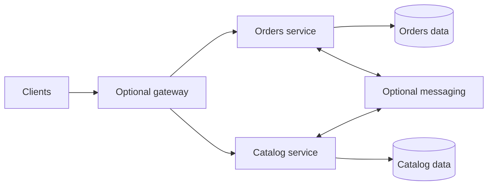

# Microservices Architecture

## At a Glance

Microservices architecture organizes an application as independently deployable services, commonly aligned to business capabilities. Services communicate through network APIs or messaging contracts and manage their own data responsibilities.

Its central trade-off is service autonomy versus distributed-systems complexity.

## The Engineering Challenge

A single application may become difficult to release, scale or own independently when different business capabilities have distinct needs. Microservices create separate deployment boundaries, but those boundaries introduce communication and operational costs.

## Architecture Blueprint

This is a conceptual example. Not every system needs a gateway or message broker. Services should use the simplest communication mechanism that fits the workflow.

## Where It Fits

Microservices may be appropriate when business capabilities have stable boundaries, teams need genuine independent ownership and releases, or different workloads have distinct scaling or reliability needs. The organization must be able to operate distributed systems.

## Trade-offs & Pitfalls

- Network calls add latency and can fail independently.
- Workflows across services raise data consistency and transaction questions.
- Debugging requires logs, metrics, traces and correlation identifiers.
- Deployment, access control, secrets and contract compatibility need automation.
- Too many small services can create excessive coordination and communication overhead.

A shared database or long chain of synchronous calls can undermine service autonomy.

## Building It in Practice

Treat each service as the owner of its business capability and data. Define stable contracts, plan for timeouts and bounded retries, make repeatable operations idempotent, and provide observability from the start.

Cross-service workflows may need eventual consistency, sagas or compensating actions. These are design choices, not automatic requirements for every service.

## When to Reconsider

A small team, an early product, a simple domain or limited operational capacity may be better served by a modular monolith. Expected future growth alone is not enough reason to introduce distributed services.

## How It Connects

Microservices can use event-driven communication, and each service can apply layered or Clean Architecture internally. These describe different aspects of a system and can be combined.

## Further Reading & References

### Official Documentation & Architecture Guides

- [Microservices architecture style - Microsoft](https://learn.microsoft.com/en-us/azure/architecture/guide/architecture-styles/microservices) - Updated: 2025-07-11
- [Choose how to segment your workload - AWS Well-Architected](https://docs.aws.amazon.com/wellarchitected/2024-06-27/framework/rel_service_architecture_monolith_soa_microservice.html)

### Engineering Publications & Essays

- [Microservices - Martin Fowler and James Lewis](https://martinfowler.com/articles/microservices.html) - Discusses service boundaries, independent deployment and the organizational and operational trade-offs.
