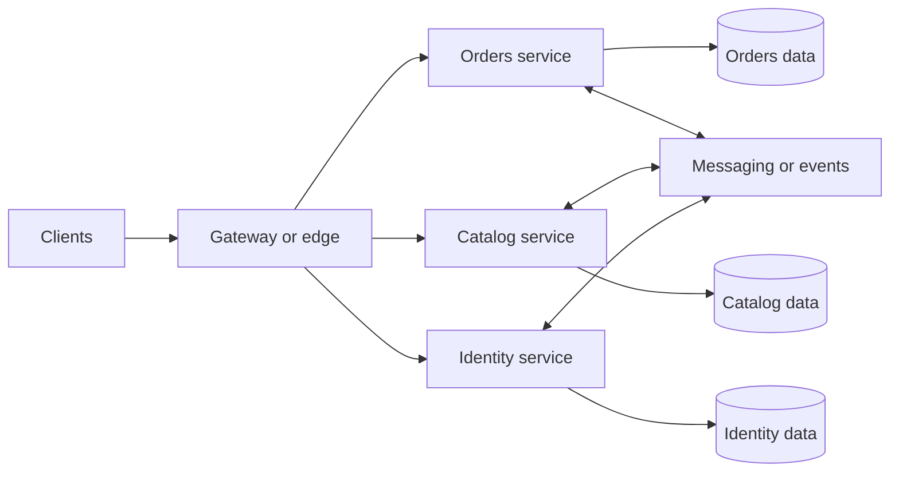

# Microservices architecture

Microservices architecture structures an application as a set of independently deployable services, commonly aligned to business capabilities or bounded contexts. Services communicate through explicit network APIs or messaging contracts and own their data responsibilities.

The central trade-off is autonomy versus distributed-systems complexity. Independent deployment is valuable only when the organization can design, operate, secure, and observe the resulting system.

## Conceptual structure

This is a conceptual view. Not every system needs an API gateway or message broker. Services should communicate using the simplest contract that satisfies the workflow.

## Core characteristics

- Services have explicit business responsibilities.
- Each service can be built and deployed independently.
- Service contracts hide internal implementation details.
- Data ownership belongs to services rather than a shared application-wide data layer.
- Failures, latency, retries, and partial availability are normal design concerns.
- Automation and observability are foundational operating capabilities.

## Benefits

- A service can be changed and released without redeploying every other service, provided contracts remain compatible.
- Teams can own a capability end to end.
- Workloads with different scaling profiles may scale independently.
- Failure isolation is possible when dependencies and resilience boundaries are designed correctly.
- Technology choices can vary where the benefit justifies the operational cost.

## Costs and failure modes

- Network calls add latency and can fail independently.
- A workflow spanning services raises data consistency and transaction questions.
- Distributed debugging requires correlation, logs, metrics, and traces.
- Service discovery, deployment, secrets, access control, and version compatibility require automation.
- Excessively small services create chatty communication and coordination overhead.
- Shared databases or synchronous dependency chains can undermine service autonomy.

## Data ownership and consistency

A service should be the authority for the data it owns. Other services should use its contract rather than directly modifying its tables.

Cross-service workflows may use eventual consistency, orchestration, sagas, outbox/inbox patterns, or compensating actions. These mechanisms add complexity and must be chosen based on business invariants. Do not assume a distributed transaction is equivalent to a local database transaction.

## Resilience and observability

Plan for timeouts, bounded retries, idempotent operations, circuit breaking where appropriate, bulkheads, graceful degradation, and clear failure ownership. Retries without limits or idempotency can amplify incidents.

Use structured logs, metrics, distributed traces, correlation identifiers, health signals, and service-level objectives. A collection of services without operational visibility is difficult to maintain safely.

## When it fits

Microservices may be justified when:

- Business capabilities have stable and meaningful boundaries.
- Multiple teams need genuine independent ownership and release cadence.
- Different capabilities have materially different scaling or reliability requirements.
- The organization can operate distributed systems with adequate automation and observability.
- The benefits outweigh the cost of network communication and data coordination.

## When it may not fit

A small team, early product, simple domain, limited operational support, or tightly coupled transaction model may be better served by a modular monolith or conventional layered application.

Do not choose microservices solely because the system is expected to grow. First identify the specific constraint that independent services solve.

## Migration considerations

Before decomposition, map business capabilities, data ownership, transactions, integrations, and deployment dependencies. Extract one bounded capability at a time, preserve contracts, and measure operational impact. A strangler approach can reduce migration risk, but it does not remove the need to manage data consistency and coexistence.

## Evidence status

Microservices do not inherently make an application faster, cheaper, more secure, or more scalable. Such claims require a defined workload, environment, versions, method, results, date, and source.

## References

- [Microsoft: Microservices architecture style](https://learn.microsoft.com/en-us/azure/architecture/guide/architecture-styles/microservices)
- [AWS: Decomposing monoliths into microservices](https://docs.aws.amazon.com/prescriptive-guidance/latest/modernization-decomposing-monoliths/)
- [AWS Well-Architected: Choose how to segment your workload](https://docs.aws.amazon.com/wellarchitected/2024-06-27/framework/rel_service_architecture_monolith_soa_microservice.html)
