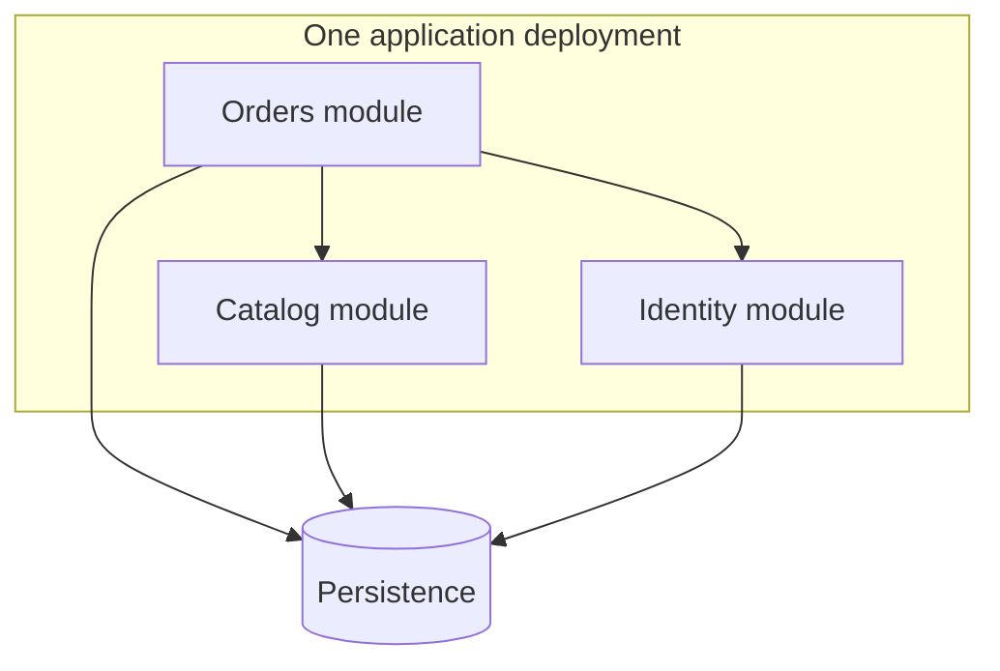

# Modular Monolith

## At a Glance

A modular monolith is one application deployment unit divided into cohesive modules with explicit boundaries. Modules may represent business capabilities such as orders, catalog or identity.

The goal is to keep deployment relatively simple without allowing the codebase to become one tightly coupled block.

## The Engineering Challenge

A single application can be straightforward to build and operate, but its internal parts may become difficult to change independently. A modular monolith addresses this by making module ownership and dependencies explicit.

## Architecture Blueprint

The diagram is illustrative. Modules may share a database while owning separate tables or schemas. The important rule is that a module should not casually access another module's internal data or code.

## Where It Fits

Consider this approach when:

- The domain needs clear business boundaries.
- Independent service deployment is not yet necessary.
- The team wants simpler local development and operations than a distributed system.
- The domain is still evolving and service boundaries are not yet clear.

## Trade-offs & Pitfalls

- Boundaries erode when developers bypass module interfaces.
- Shared tables can create hidden coupling.
- All modules usually share one application release and scaling unit.
- Poorly separated modules can become a tightly coupled monolith with extra ceremony.

A modular monolith requires deliberate boundaries and tests that help protect them. The name alone does not make an application modular.

## Building It in Practice

For each module, define its business responsibility, public interface, data ownership and permitted dependencies. Prefer cohesive modules that change together; do not create a separate module for every class or database table.

## When to Extract a Service

Extract a module only when there is a concrete reason for independent deployment, scaling, security isolation, reliability or team ownership. Extraction also introduces network failures, data consistency and operational responsibilities.

## How It Connects

A modular monolith can use layered organization or Clean Architecture inside its modules. It can also use events for communication without becoming a microservices system.

## Scope Note

Research on modular monoliths is still developing, and terminology is not fully consistent across the literature. This page focuses on practical structural characteristics rather than claiming measured performance advantages.

## Further Reading & References

### Official Documentation & Architecture Guides

- [Choose how to segment your workload - AWS Well-Architected](https://docs.aws.amazon.com/wellarchitected/2024-06-27/framework/rel_service_architecture_monolith_soa_microservice.html)

### Research & Technical Reports

- [Modular Monolith Architecture in Cloud Environments: A Systematic Literature Review - Future Internet](https://www.mdpi.com/1999-5903/17/11/496) - Published: 2025-10-29
- [Modular Monolith: Is This the Trend in Software Architecture? - Ruoyu Su and Xiaozhou Li](https://doi.org/10.1145/3643657.3643911) - Published: 2024-08-23
