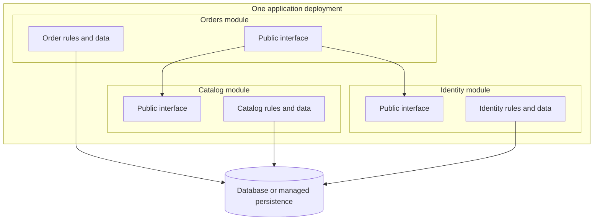

# Modular monolith

A modular monolith is one application deployment unit organized into cohesive modules with explicit boundaries and controlled dependencies. It combines a relatively simple deployment model with deliberate internal structure.

The term is not a guarantee of quality. A monolith is modular only when its boundaries are meaningful and reasonably enforced.

## Conceptual structure

The diagram is illustrative. A modular monolith may use one database with module-owned tables, separate schemas, or other persistence arrangements. The critical property is that modules do not casually reach into one another's internals.

## Core characteristics

- One primary application deployment unit.
- Modules aligned to business capabilities or cohesive areas of the domain.
- Explicit public interfaces between modules.
- Clear ownership of module data and business rules.
- Dependency rules that prevent arbitrary cross-module access.
- Tests that verify important module boundaries.

## Benefits

- Avoids network calls between modules that run in the same process.
- Keeps deployment and local development simpler than a distributed fleet of services.
- Allows teams to establish domain boundaries before deciding whether independent deployment is necessary.
- Can support later extraction of a module when a real operational or organizational need appears.

## Costs and failure modes

- Boundaries erode if developers bypass module interfaces.
- A shared database can become a source of hidden coupling.
- Independent scaling and deployment are limited by the application unit.
- A single release may require coordination across modules.
- Poorly separated modules can become a tightly coupled monolith with more ceremony.

## Boundary design

For each module, define:

1. The business capability it owns.
2. Its public commands, queries, or interfaces.
3. The data it owns and the data it may read from elsewhere.
4. The dependencies it is allowed to have.
5. The events or contracts it exposes to other modules.
6. How boundary violations are detected.

Prefer cohesive modules that change together. Avoid splitting every entity or database table into its own module.

## When it fits

Consider a modular monolith when:

- The product needs clear business boundaries.
- The team is small or medium-sized, or operational capacity is limited.
- Independent deployment is not yet a real requirement.
- Strong consistency across workflows is important.
- The domain is evolving and service boundaries are not yet well understood.

## When to extract a service

Consider extraction only when a module has a concrete reason to own a separate deployment lifecycle—for example, distinct scaling needs, security isolation, team ownership, reliability requirements, or technology constraints.

Before extraction, assess network failure, data ownership, consistency, observability, deployment automation, and operational support. Extraction is a distributed-systems change, not merely moving code to another repository.

## Relationship to other styles

A modular monolith can use layered organization inside each module and Clean Architecture dependency rules within selected modules. It can also publish domain events while remaining a single deployment unit.

## Evidence status

This page describes design trade-offs. It does not claim that modular monoliths universally outperform microservices.

## References

- [AWS Prescriptive Guidance: Decomposing monoliths into microservices](https://docs.aws.amazon.com/prescriptive-guidance/latest/modernization-decomposing-monoliths/)
- [AWS Well-Architected: Choose how to segment your workload](https://docs.aws.amazon.com/wellarchitected/2024-06-27/framework/rel_service_architecture_monolith_soa_microservice.html)
